# Piano roll for Furnace

English | [Português](README.pt-BR.md)

A fork of [Furnace](https://github.com/tildearrow/furnace) v0.6.8.3 that adds a per-channel piano roll window. The roll reads and writes the tracker's patterns directly. There is no new song format: everything you do in the roll becomes ordinary notes, instruments, volumes and effects that stock Furnace opens as usual.

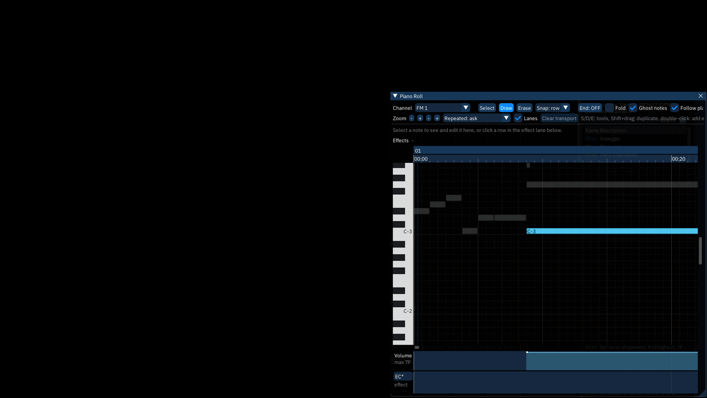

## Download

[Releases](https://github.com/gustavopagan/furnace_pianoroll/releases) page:

| System | File |
|---|---|
| Windows 64-bit | `...-Windows-x86_64.zip`: unzip and run `furnace.exe` |
| macOS Apple Silicon (M1 and later) | `...-macOS-arm64.dmg` |
| macOS Intel | `...-macOS-x86_64.dmg` |
| Linux x86_64 | `...-Linux-x86_64.tar.gz`: extract and run `./furnace` |

The executables are not code-signed. On Windows, click "More info" > "Run anyway" (or right-click the zip > Properties > Unblock before extracting). On macOS, the first time, right-click > Open.

## Contents

- [Opening the window](#opening-the-window)
- [The window, top to bottom](#the-window-top-to-bottom)
- [Creating, moving and deleting notes](#creating-moving-and-deleting-notes)
- [Selecting several notes](#selecting-several-notes)
- [Changing the instrument](#changing-the-instrument)
- [Repeated patterns](#repeated-patterns)
- [Note panel and effects](#note-panel-and-effects)
- [Portamento](#portamento)
- [Volume and effect lanes](#volume-and-effect-lanes)
- [Snap and sub-row timing](#snap-and-sub-row-timing)
- [Row names and Fold](#row-names-and-fold)
- [Sync with the tracker](#sync-with-the-tracker)
- [DAW-style transport](#daw-style-transport)
- [Shortcuts](#shortcuts)
- [Files, language and limits](#files-language-and-limits)

## Opening the window

`window` > `piano roll`, or **Ctrl+Shift+R** (rebindable in Settings > Keyboard).

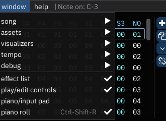

## The window, top to bottom

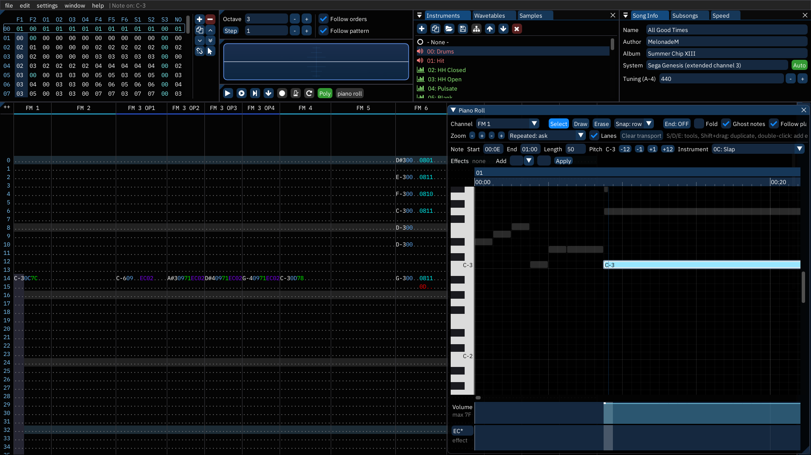

- **Toolbar, row 1:** channel, tools (Select **S**, Draw **D**, Erase **E**), Snap, how drawn notes end (OFF or REL), Fold, Ghost notes, Follow playback.
- **Toolbar, row 2:** horizontal and vertical zoom, what to do with repeated patterns, Lanes, Clear transport, and hints or warnings.
- **Note panel:** start, end, length, pitch, instrument and effects of the selected note (or notes).
- **Arrangement bar:** one block per order position. Repeated patterns are amber with "xN". Click a block to scroll there.
- **Ruler:** rows and bars. Click to set the play marker.
- **Roll:** keyboard on the left and the channel's notes. The other channels of the same chip are shown in gray (Ghost notes).
- **Lanes:** volume and one effect of your choice, row by row.

## Creating, moving and deleting notes

| Action | How |
|---|---|
| Create | Draw tool: click (uses the last length) or click and drag |
| Move | drag the body of a note |
| Change length | drag the right edge |
| Duplicate | Shift + drag (the copy lands next to the original, never on top of it) |
| Delete | Delete key, or the Erase tool (click or drag over notes) |
| Undo / redo | Ctrl+Z / Ctrl+Y (the tracker's own history) |

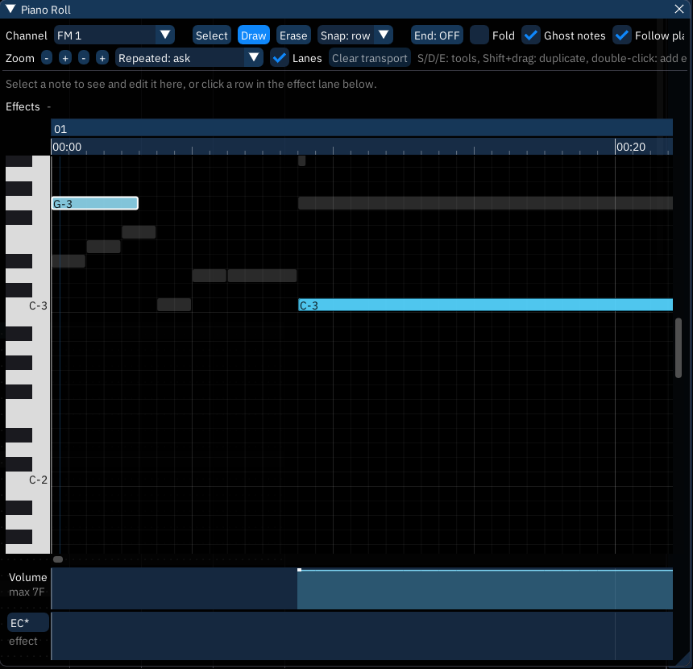

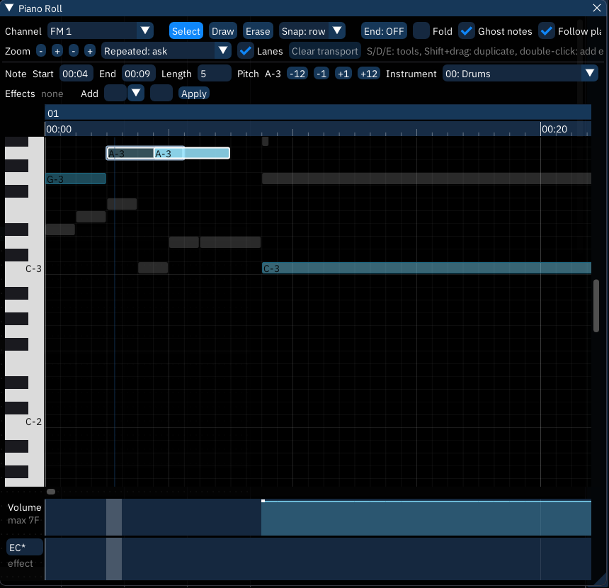

Each gesture is a single undo step. A tracker channel is monophonic: a note starts where the previous one ends. The roll therefore never deletes a note that is not part of the edit; the edited note is the one that gets shorter.

Moving or duplicating a note takes along the effects on its start row, that row's volume and an `ECxx` cut inside the note. Song-wide effects (speed, tempo, order jumps, stop) stay where they are.

## Selecting several notes

With Select, drag a rectangle on empty space. Ctrl+click adds or removes a note. Ctrl+A selects all, Esc clears. Dragging one selected note moves them all.

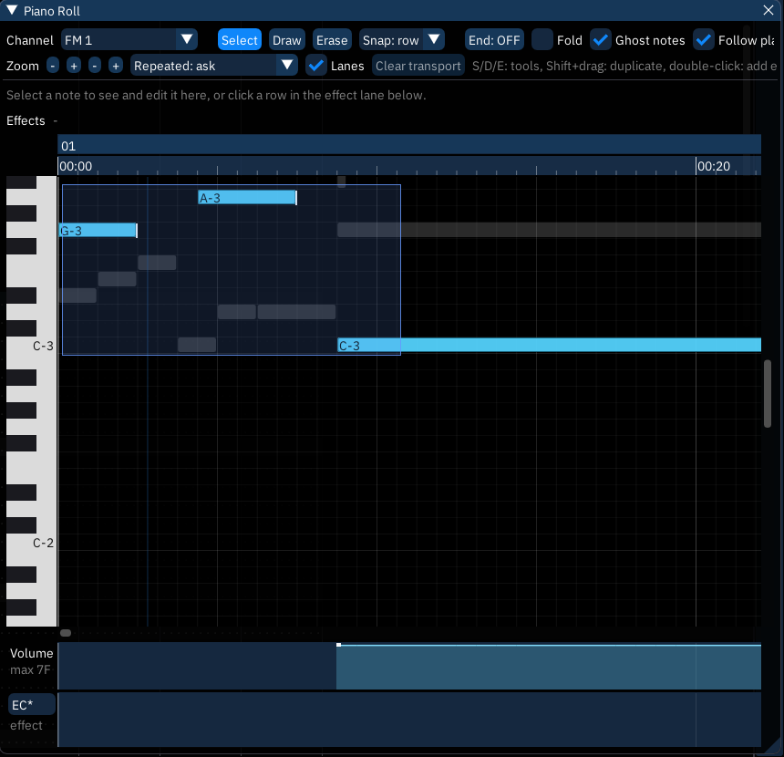

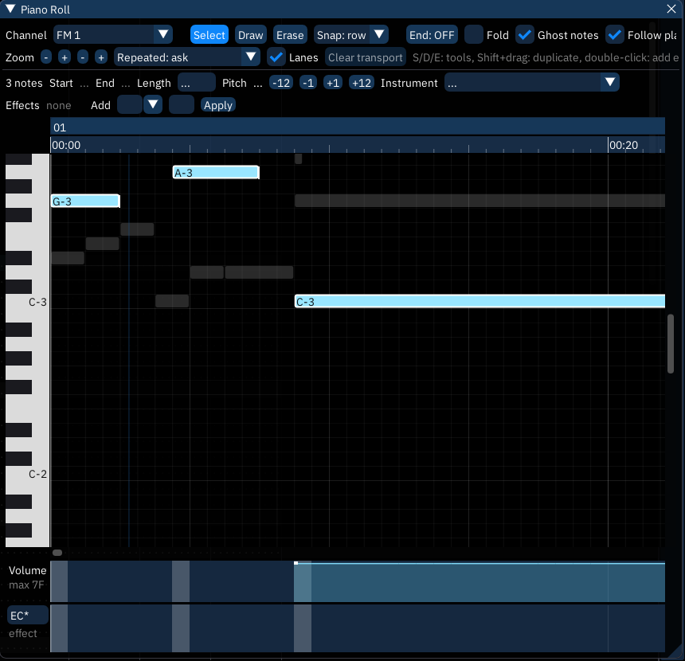

## Changing the instrument

With notes selected, click an instrument in the Instruments list and it is applied to all of them. The Instrument selector in the panel does the same.

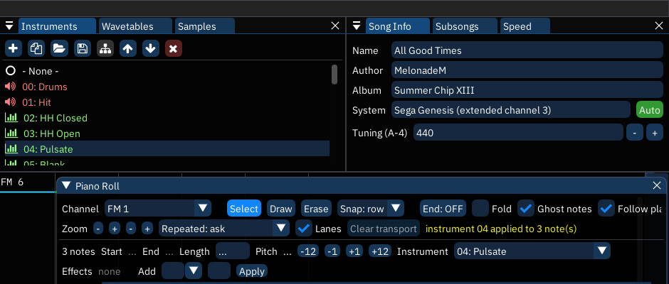

## Repeated patterns

When an edit falls in a pattern used at more than one order position, the roll asks whether to edit all of them, make the pattern unique at that position, or cancel. The answer is remembered until Furnace is closed and can be changed with the "Repeated" selector in the toolbar.

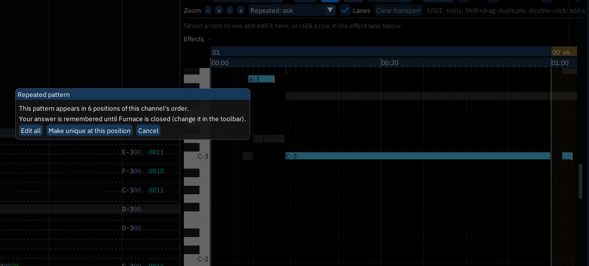

## Note panel and effects

Shows the selected note, or several ("..." where values differ). Start and end use order:row in hex, as in the tracker. Length, transpose (-12, -1, +1, +12) and instrument apply to every selected note.

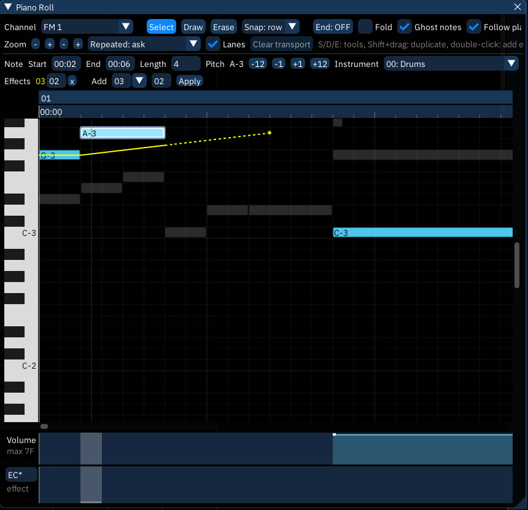

**Effects** are grouped by code:

- editing a value changes the rows that already have that effect;
- **+N** adds it to the N notes that do not;
- **x** removes it;
- **Add** writes a new effect on all of them: type the code, Enter, the value, Enter (or click Apply).

Double-clicking a note jumps to the Add field. Rows without a free effect column are skipped and the toolbar says so. The roll never adds effect columns by itself; use the `++` button in the channel's corner in the tracker for that.

## Portamento

A note with `03xx` gets a yellow line that leaves the previous note, ramps to the new pitch and runs through the note. The ramp length is the real slide time, computed the way Furnace does it in linear pitch mode (the default).

Drag the dot at the end of the ramp left or right and the `03` value changes with it (shorter ramp, faster slide).

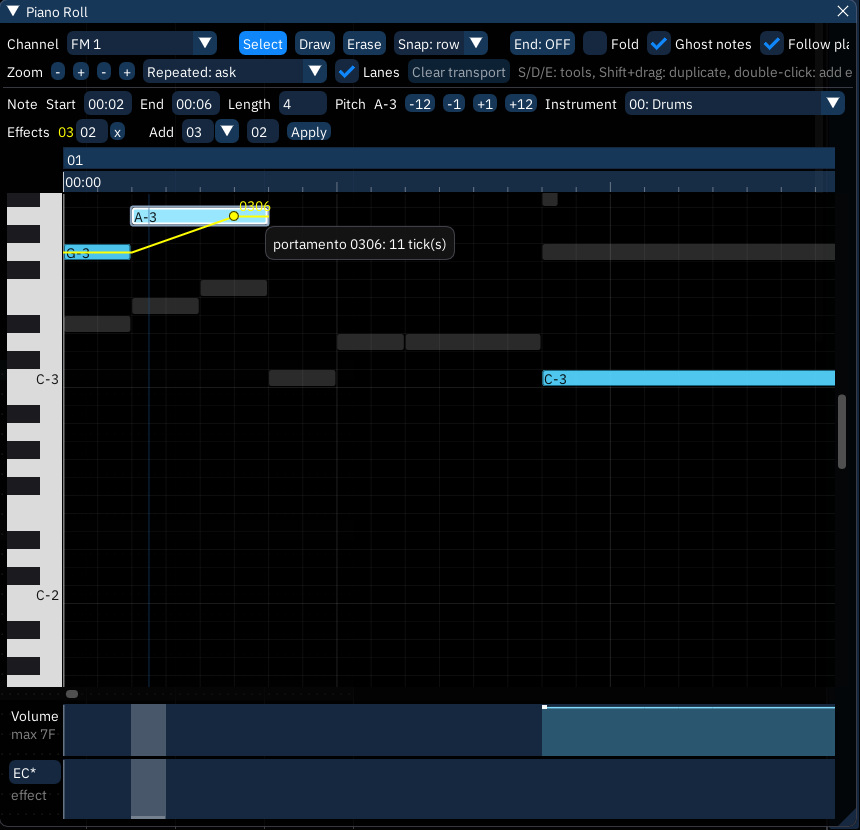

A hollow circle means the note has `03` but nothing is sounding before it, so it will not slide.

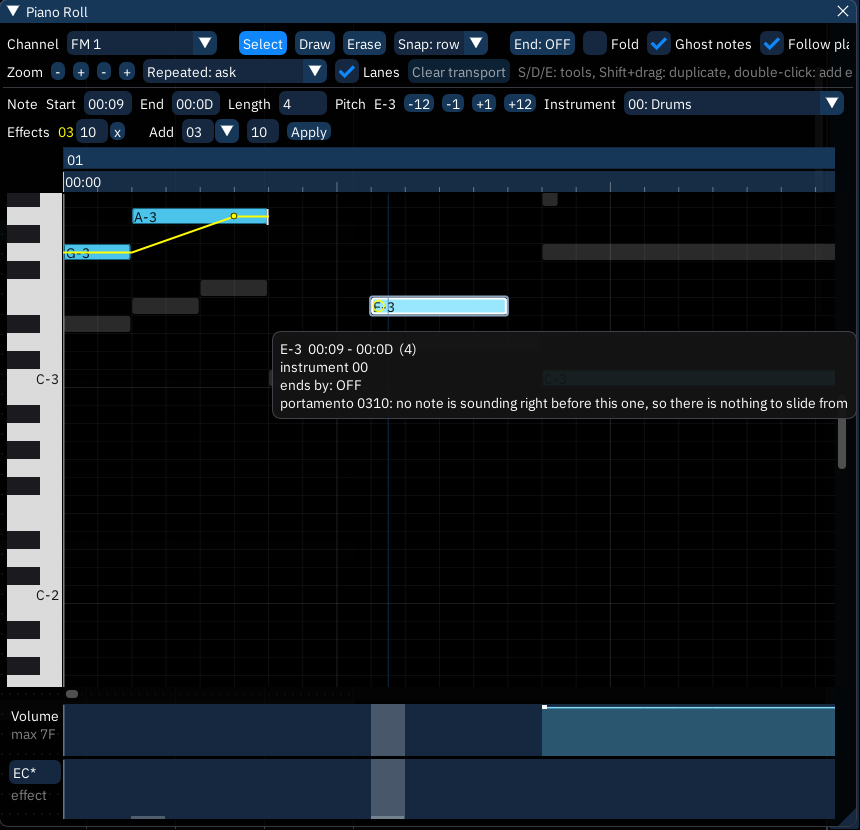

## Volume and effect lanes

Turn them on with the **Lanes** button.

- **Volume:** steps showing the volume in force (it holds until the next write). Drag to draw; right button or Erase clears.

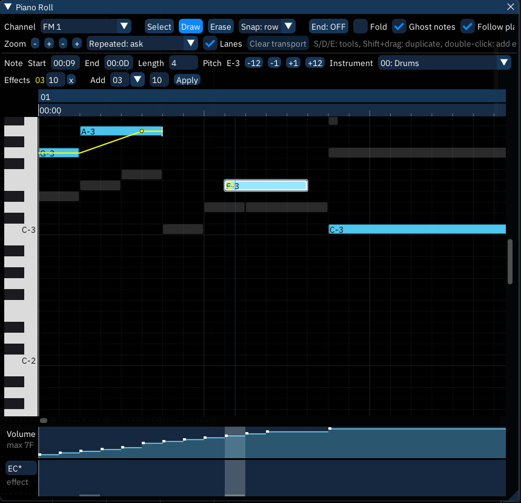

- **Effect:** the selector on the left picks the effect; `*` means "the most used in this channel". Bar height is the value (0 to FF). With Draw, dragging writes the effect; right button or Erase removes it. Clicking a row shows it in the note panel even when no note starts there. That is how loose effects, such as an `EC04` in the middle of a note, are edited.

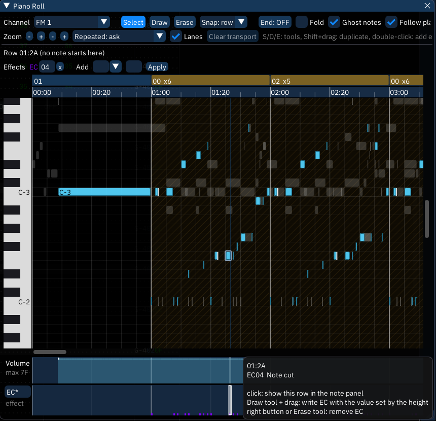

## Snap and sub-row timing

The **Snap** selector sets the grid:

- **row:** notes on rows;
- **1/2** and **tick:** starts and ends inside a row, written as `EDxx` (delay) and `ECxx` (cut).

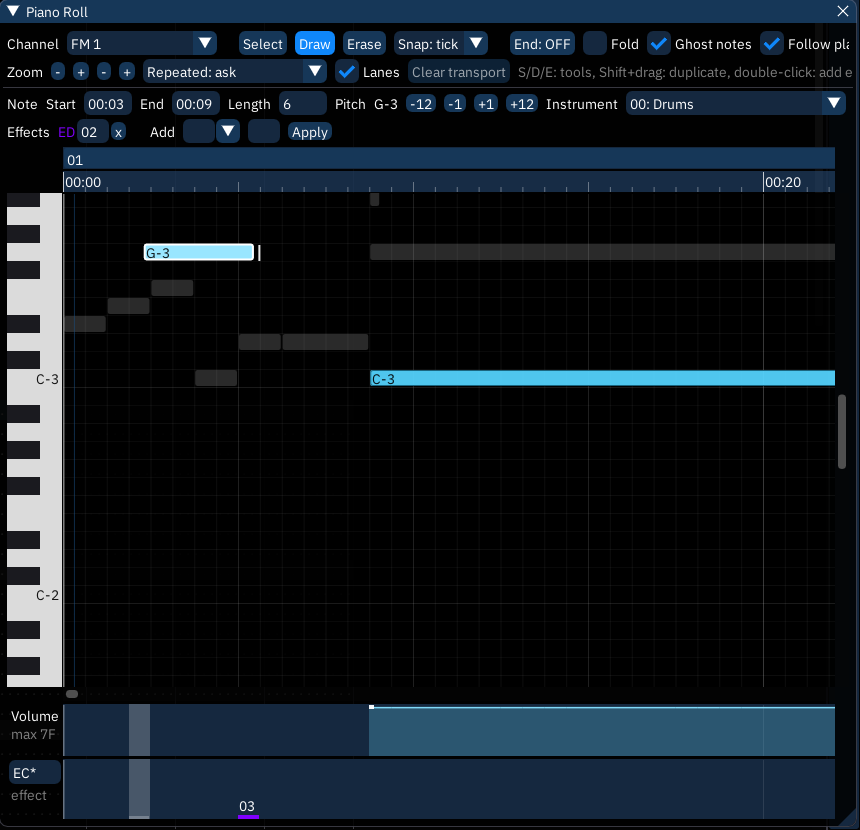

Dragging in tick mode, the note starts and ends in the middle of a row:

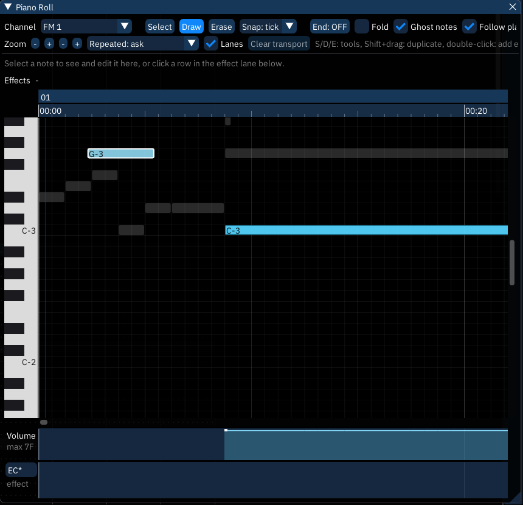

In the tracker the result is ordinary effects:

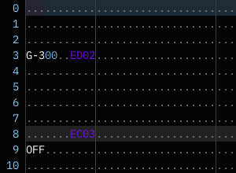

If there is no free effect column for the `ED` or `EC`, the whole edit is refused and nothing changes.

## Row names and Fold

Right-click a key on the roll's keyboard to name that pitch in this channel ("kick", "snare", a sample name). The name shows on the key and inside the notes.

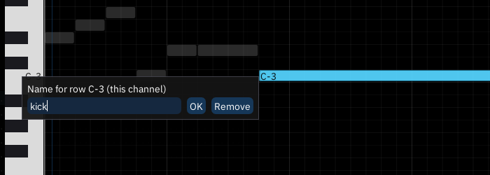

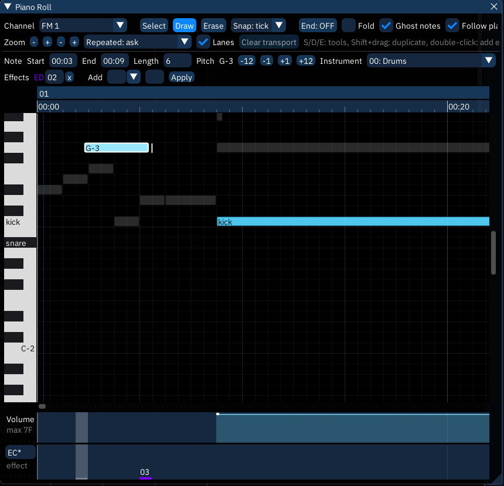

**Fold** hides pitches that have neither notes nor a name, which helps with drums:

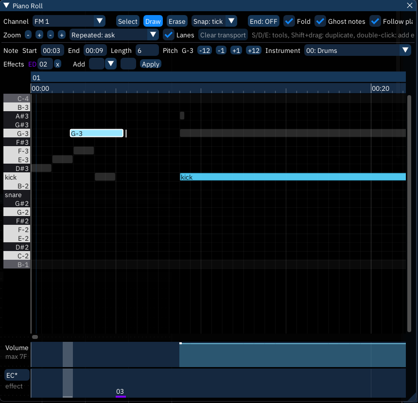

## Sync with the tracker

Clicking a note moves the tracker cursor to it. Moving the tracker cursor brings the roll to that channel and row; an outline in the roll shows where the cursor is. During playback the roll leaves the tracker cursor alone. **Follow playback** makes the roll scroll with the song.

## DAW-style transport

Turn on the **piano roll** button next to Poly in the play controls:

With it on:

- **Space** is play/stop in any window (overriding Furnace's usual binding), except while typing in a field;
- click the ruler to set the **marker**: play always starts there until you click **Clear transport**. Clicking the ruler while playing jumps there;
- **I** sets the loop start at the marker and **O** sets the end. With **Repeat pattern** on (the circular arrows button), playback loops inside the selection and cuts notes at the loop point;
- **Clear transport** removes the marker and the loop. F5 still plays from the start of the song.

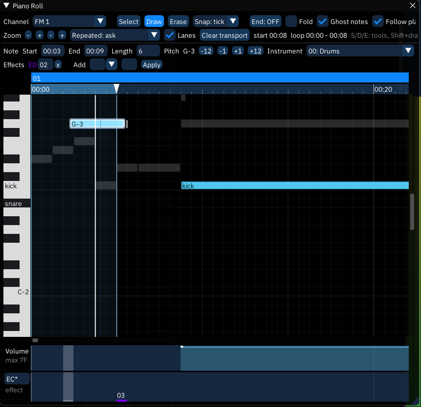

The light band on the ruler is the loop, the triangle is the marker and the white line is the playback position. The toolbar shows "start" and "loop" as order:row.

With the button off, Furnace behaves like the original.

## Shortcuts

| Key | Function |
|---|---|
| Ctrl+Shift+R | open the piano roll |
| S / D / E | Select / Draw / Erase |
| Delete | delete the selected notes |
| Ctrl+A / Esc | select all / clear selection |
| Shift + drag | duplicate |
| Ctrl + click | add to or remove from the selection |
| Ctrl+Z / Ctrl+Y | undo / redo |
| Space | play/stop (with the piano roll button on) |
| I / O | loop start / end at the marker |
| right-click on the keyboard | name the row |

## Files, language and limits

**Files.** Per-channel preferences (OFF/REL ending, Fold, row names) live next to the song in `<song>.fur.roll.json`. The `.fur` format is unchanged. Zoom, channel, tool, Snap, Ghost, Follow and Lanes are kept in Furnace's configuration.

**Language.** The window's texts are translated to Brazilian Portuguese. Pick the language in Settings > General > Language and restart Furnace. The `locale` folder must sit next to the executable.

**Known limits.**

- One channel is edited at a time.
- The marker and loop work in rows, not ticks, and last until Furnace is closed.
- In songs that do not use linear pitch, the portamento ramp is approximate (drawn dashed).
- The executables are not code-signed.

## Source code and license

GPL-2.0-or-later, like Furnace. The code is in this repository on the `piano-roll` branch; the changes over v0.6.8.3 can be seen by comparing with the `v0.6.8.3` tag. Build instructions are in [BUILD.md](BUILD.md).
